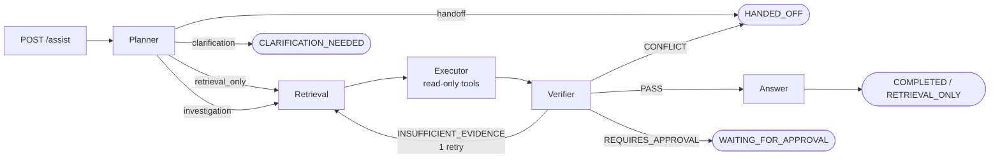

# incident-copilot

A controlled agentic workflow for on-call engineers: it helps investigate incidents without acting blindly.

The agent searches runbooks and postmortems, gathers data through read-only tools (metrics, deploys, logs, dependency status), and a separate verifier checks that every conclusion is backed by evidence. The agent only **proposes** risky actions such as a rollback; a human approves and carries them out.

> **Status:** early stage. The repo currently has the scaffolding, domain models, synthetic fixtures and a FastAPI app with a stub `/assist` endpoint. Everything marked _planned_ below is not implemented yet.

## Why

An LLM agent in on-call is dangerous in two ways: it can confidently present an unconfirmed hypothesis, and it can touch production without asking. This project shows how to build an agent you can trust:

- **Answers only with evidence.** Every claim cites a specific fact from a document or a tool result. If nothing confirms it, the agent asks a clarifying question or hands the incident off to a human.
- **Deterministic control around the LLM.** Routes, budgets, permissions and final states are enforced in code, not in the prompt.
- **Predictable termination.** Every run ends in exactly one `TerminationOutcome` with a reason code. No infinite loops.
- **Measurable behavior.** The agent is evaluated offline against frozen cases, not by eyeballing outputs.

## Quick start

Requires Python 3.13 and [uv](https://docs.astral.sh/uv/).

```bash
make install   # uv sync
make run       # FastAPI dev server at http://127.0.0.1:8000
```

Try it:

```bash
curl http://127.0.0.1:8000/health
# {"status":"ok"}

curl -X POST http://127.0.0.1:8000/assist \
  -H 'Content-Type: application/json' \
  -d '{"query": "checkout is returning 5xx after a deploy, what is going on?"}'
# {"run_id":"...","answer":"Received: ..."}   <- stub for now
```

Swagger UI: http://127.0.0.1:8000/docs

### Development commands

| Command          | What it does                                     |
| ---------------- | ------------------------------------------------ |
| `make fmt`       | `ruff format` + `ruff check --fix`               |
| `make lint`      | check formatting and lint rules                  |
| `make typecheck` | `mypy --strict` over `src` and `tests`           |
| `make test`      | `pytest`                                         |
| `make check`     | lint + typecheck + test; run before every commit |

## How it works (target architecture)



The budget (steps, time, tool calls, tokens) is checked on every transition; when it runs out, the run ends with `BUDGET_EXHAUSTED`.

### 1. Orchestration (LangGraph)

- A `planner → retrieval → executor → verifier → answer` graph with typed state.
- The Planner picks a **route** based on the request type: `retrieval_only`, `investigation`, `clarification`, `handoff`. It does not pick the incident cause.
- The cause (`deploy_regression`, `dependency_outage`, `config_error`, `unknown`) stays a hypothesis until evidence confirms it.
- Final states: `COMPLETED`, `RETRIEVAL_ONLY`, `CLARIFICATION_NEEDED`, `REFUSED`, `HANDED_OFF`, `WAITING_FOR_APPROVAL`, `BUDGET_EXHAUSTED`.

### 2. Typed tool layer

| Tool                    | Kind          | Returns                                          |
| ----------------------- | ------------- | ------------------------------------------------ |
| `get_service_health`    | read-only     | error rate and p99 latency of a service          |
| `get_recent_deploys`    | read-only     | recent deploys: version, author, status, summary |
| `search_logs`           | read-only     | log entries by service, level and time window    |
| `get_dependency_status` | read-only     | status of external dependencies                  |
| `propose_rollback`      | approval-only | builds a proposal, executes nothing              |

- Pydantic contracts for inputs and outputs, JSON Schema, a timeout and retry policy per tool.
- RBAC based on which team owns a service, so data a team can't access never reaches the prompt.
- Field minimization: the LLM only sees what it needs, tagged with `source`, `fetched_at` and `trace_id`.
- Result statuses `ok / error / timeout / denied`, plus an audit log of every call.
- A failed **optional** tool does not block the answer, but it is recorded in `unverified_checks` and the answer must mention it.

### 3. Evidence verification

- **Evidence ledger:** every fact from a document or tool gets an id and a link to its source.
- **Verifier:** deterministic checks first (required evidence present, right service, right time window, data fresh enough), then an LLM check for sufficiency and contradictions.
- Verdicts: `PASS`, `INSUFFICIENT_EVIDENCE`, `CONFLICT`, `REQUIRES_APPROVAL`.
- When evidence is insufficient, the agent rewrites the query once and retries retrieval, then falls back to clarification or handoff.
- **Citation validation:** the id exists, the quoted fragment really appears in the source, and the data falls within the incident window. Unsupported claims are removed.

There are two different retries, and they should not be confused. The orchestrator retries a transient tool error (such as a timeout) before the verifier runs. The verifier handles missing evidence by sending the run back to retrieval.

### 4. Evaluation and observability

- Frozen cases in YAML: input, expected route, tools and arguments, verdict, termination, citations.
- Every run's trajectory is recorded and can be replayed against recorded tool fixtures.
- Metrics: routing accuracy, tool selection, argument validity, retrieval sufficiency, citation correctness, unsupported-claim rate, successful termination.
- A regression gate in pytest for prompt, model or graph changes.
- OpenTelemetry spans for every node and every tool call.

## Data

The whole domain is synthetic and lives in `data/`.

**Services and owning teams** (the basis for RBAC):

| Service     | Team            | Depends on                |
| ----------- | --------------- | ------------------------- |
| `checkout`  | `team-commerce` | payments, inventory, auth |
| `payments`  | `team-payments` | auth, psp-gateway         |
| `inventory` | `team-commerce` | postgres-main             |
| `auth`      | `team-platform` | postgres-main             |

**Fixtures** (`data/fixtures/`) stand in for the live production state that tools read:

- `services.json`: services, owners, dependencies
- `dependencies.json`: external dependencies and their status
- `deploys.json`: deploy history
- `metrics.json`: `error_rate` and `latency_p99_ms`
- `logs.jsonl`: log entries with version and `trace_id`

All timestamps are timezone-aware UTC. Fixtures are validated strictly on load (`extra="forbid"`, frozen models), and cross-file references are checked.

**Documents** (`data/docs/`, _planned_): about 10 runbooks and 5 postmortems in Markdown for retrieval.

## Repository layout

```
src/incident_copilot/
  api/
    app.py        # create_app(), GET /health, POST /assist
    schemas.py    # AssistRequest / AssistResponse, query length limit
  domain/
    models.py     # Service, Dependency, Deploy, MetricPoint, LogEntry
    loaders.py    # fixture loading and cross-file validation
data/fixtures/    # synthetic service state
tests/            # API and loader tests
```

## Stack

Now: Python 3.13, uv, FastAPI, Pydantic v2, pytest, ruff, mypy (strict).

Planned: LangGraph, OpenAI and Anthropic behind a shared `LLMProvider` interface, FAISS, PostgreSQL (checkpoints, approval and resume, audit log), OpenTelemetry.
